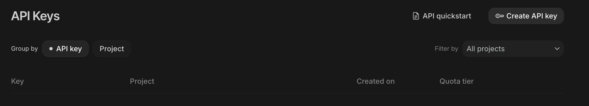
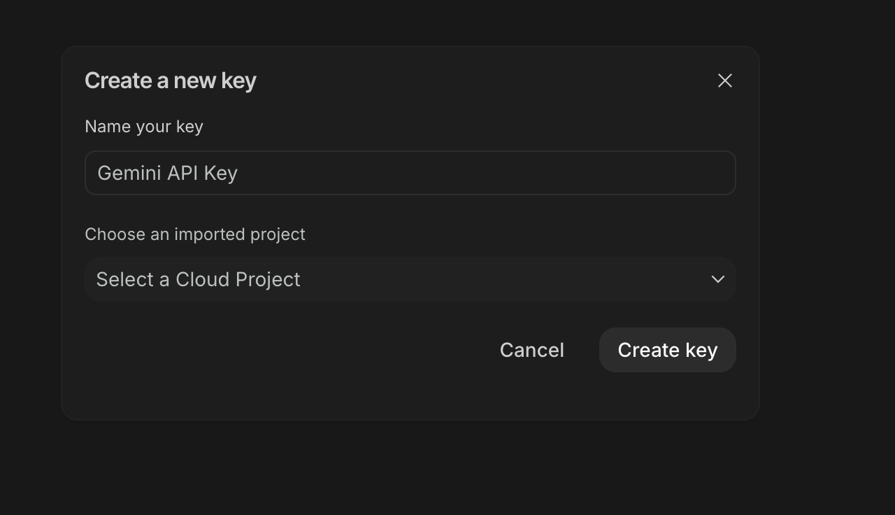
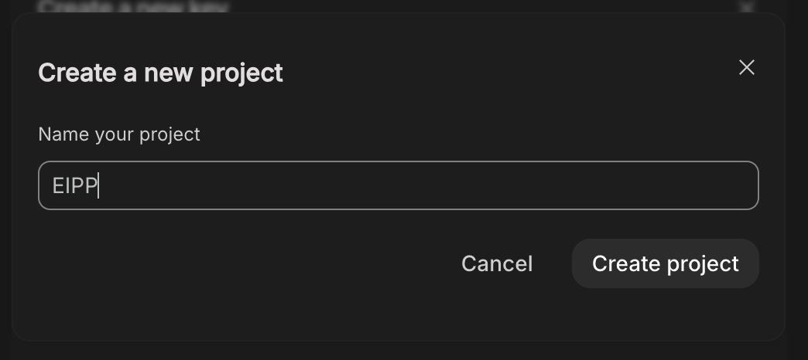
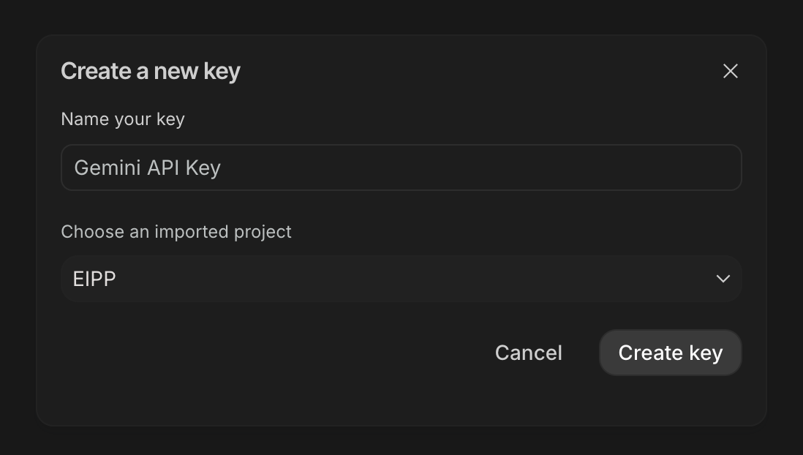
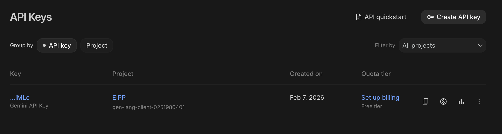

# Getting Gemini API key

## Table of Contents

1. [What is an API key and why do we need one?](#what-is-an-api-key-and-why-do-we-need-one)
2. [Getting Gemini API key](#getting-gemini-api-key)

## What is an API key and why do we need one?

An **API key** is a unique string of characters that acts as a password between your code and an external service. When you send a request to the Gemini API, you include your key so that Google can identify who is making the request, track usage against your quota, and block unauthorized access.

We need an API key because the Gemini models run on Google's servers, not on your computer. Your Python script communicates with those servers over the internet through the API (Application Programming Interface), and the key is what proves you have permission to use it.

## Getting Gemini API key

Google offer the possibility to use its Gemini models for free within a certain quota. To consult the quota see [here](https://ai.google.dev/gemini-api/docs/rate-limits).

In order to use the Gemini API, however, you need to get an API key. To get the API key, you need to go to [Google AI Studio](https://aistudio.google.com/welcome) and click the "Get an API key" button.

You will be taken to the API Keys page. Click the "Create API key" button.

A dialog will appear asking you to name your key and choose a project. If you don't have a project yet, you can create one by clicking "Create a new project" in the dropdown and giving it a name (e.g. "EIPP").

Once your project is selected, click "Create key" to generate a new API key.

Your new API key will appear in the API Keys list. Save it in a safe place.

Once you have your key, head to the [exercise](exercises/1_exercise/exercise_gemini_api.md) to set it up and test it with Python inside your `playground/` environment.