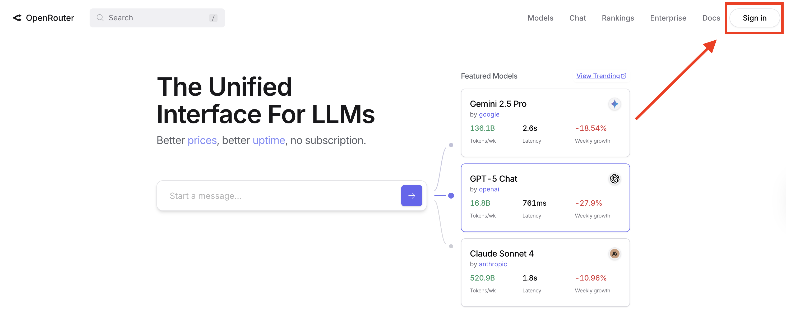
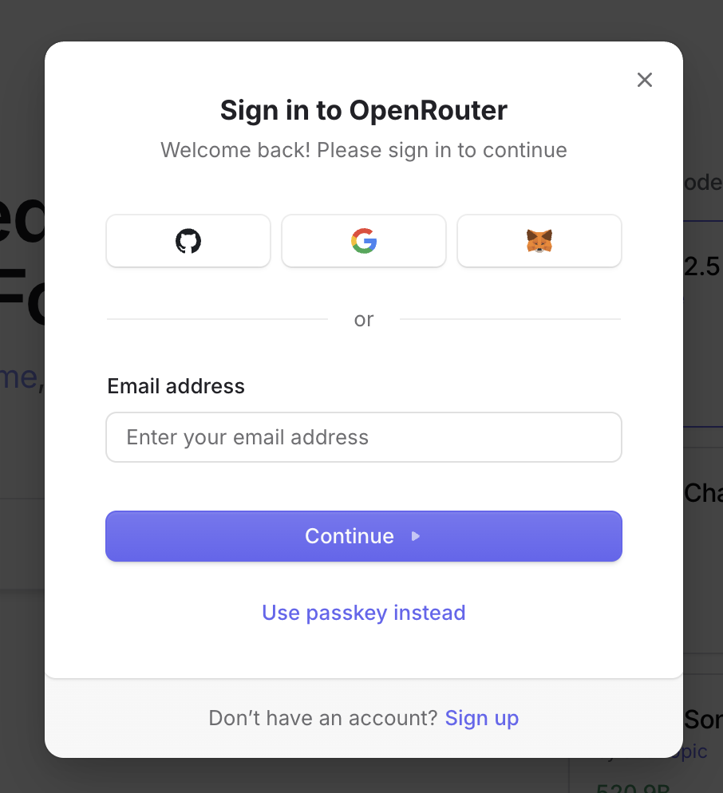
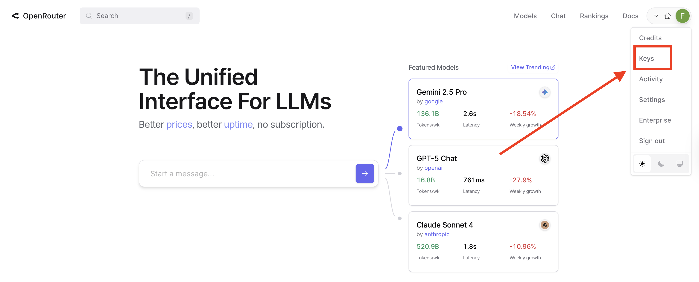
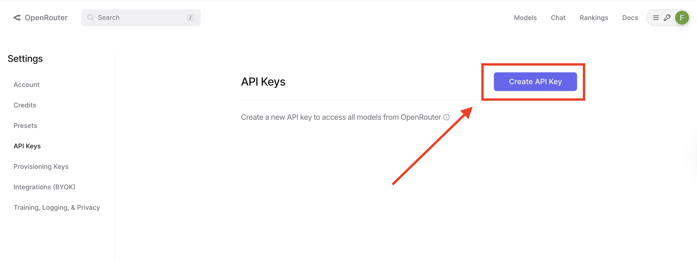

# Index

* [OpenRouter](#openrouter)
* [Getting the API key from OpenRouter](#getting-the-api-key-from-openrouter)
* [Installing the required packages](#installing-the-required-packages)
* [Using OpenRouter with LangChain](#using-openrouter-with-langchain)
* [Convenience helper function](#convenience-helper-function)
* [Browsing available models](#browsing-available-models)
* [Combining with LangChain chains](#combining-with-langchain-chains)
* [Exercises](#exercises)

## OpenRouter

OpenRouter is a platform that lets you use models from many different providers (Google, Meta, Mistral, etc.) through a single API. The key idea is that all models on OpenRouter follow the **OpenAI API format** — a widely-adopted standard for structuring LLM requests and responses. This means tools built for OpenAI (like LangChain's `init_chat_model` with `model_provider="openai"`) work with OpenRouter too.

You can consult the [official documentation](https://openrouter.ai/docs/quickstart) for more information.

**Why use OpenRouter?**
- **Avoid rate limits:** Gemini's free tier has strict limits (15 requests/minute). OpenRouter's free models give you alternatives when you hit those limits.
- **Model comparison:** Easily test different models (Google, Meta, Mistral) with the same code — just change the model name string.
- **Resilience:** If one provider's API is down, switch to another instantly.

## Getting the API key from OpenRouter

To get an API key, you need to create an account on the [OpenRouter website](https://openrouter.ai/).

Once there, click on the "Sign in" button:



Choose a method to sign in. You can use your Google account, your GitHub account, your GitLab account, or your email address.



Once you have signed in, click on your profile picture in the top right corner and then on "Keys":



Then click on the "Create API key" button to generate a new API key:



Once you have the API key, add it to your `.env` file in the `playground/` folder (on a new line, right after your `GOOGLE_API_KEY`):

```
OPENROUTER_API_KEY=YOUR_API_KEY
```

Your `.env` file should now look like this:
```
GOOGLE_API_KEY=your_gemini_key_here
OPENROUTER_API_KEY=sk-or-v1-xxxxx
```
> [!NOTE]
> Each key goes on its own line, with no spaces around the `=` sign. No quotes needed.

## Installing the required packages

Before we start, make sure you are in the `playground/` folder, then install the OpenAI integration for LangChain:

> [!TIP] Terminal
> ```bash
> uv add langchain-openai
> ```

This installs **langchain-openai**, which provides the OpenAI-compatible backend for `init_chat_model`. Since OpenRouter uses the same API format as OpenAI, we can use `model_provider="openai"` to talk to OpenRouter.

## Using OpenRouter with LangChain

Since OpenRouter uses the OpenAI API format, we can use the same `init_chat_model` function from the LangChain guide — we just need to change a few things:

1. Set `model_provider="openai"` (because OpenRouter speaks the OpenAI API format)
2. Set `base_url` to point to OpenRouter instead of OpenAI
3. Use our `OPENROUTER_API_KEY` instead of an OpenAI key

```python
from langchain.chat_models import init_chat_model
import os
from dotenv import load_dotenv

load_dotenv()

llm = init_chat_model(
    model="google/gemma-3-27b-it:free",
    model_provider="openai",  # OpenRouter uses OpenAI-compatible API format
    base_url="https://openrouter.ai/api/v1",
    api_key=os.environ["OPENROUTER_API_KEY"],
    temperature=0.2,
)

response = llm.invoke("What approved drugs can be used to treat melanoma?")
print(response.text)
```

> [!NOTE]
> We use `model_provider="openai"` because OpenRouter speaks the OpenAI API format. This is consistent with `init_chat_model` from the LangChain guide and makes it easy to swap between providers.

Why does this work? OpenRouter deliberately mirrors the OpenAI API specification. So any tool that speaks the OpenAI format — like `init_chat_model` with `model_provider="openai"` — works out of the box with OpenRouter.

## Convenience helper function

Since the `base_url` and `api_key` are always the same when using OpenRouter, we can write a short helper function to avoid repeating ourselves.

Since you'll often want to test multiple models in the same script, this helper saves you from repeating the same configuration code:

```python
def make_openrouter_llm(model_name, temperature=0.2):
    """Create a LangChain chat model that uses OpenRouter."""
    return init_chat_model(
        model=model_name,
        model_provider="openai",
        base_url="https://openrouter.ai/api/v1",
        api_key=os.environ["OPENROUTER_API_KEY"],
        temperature=temperature,
    )
```

Usage:

```python
llm = make_openrouter_llm("google/gemma-3-27b-it:free")
response = llm.invoke("What is the capital of France?")
print(response.text)
```

This makes it easy to switch between models — just change the model name string.

## Browsing available models

OpenRouter hosts hundreds of models. Many of them are **free** to use. You can browse the free models at:

[https://openrouter.ai/models?pricing=free](https://openrouter.ai/models?pricing=free)

Model names follow the pattern `provider/model-name`. Free models have `:free` appended to the name, for example:
- `google/gemma-3-27b-it:free`
- `deepseek/deepseek-r1-0528:free`
- `nvidia/nemotron-3-nano-30b-a3b:free`

**Recommended free models for biology tasks:**
- `google/gemma-3-27b-it:free` — similar quality to Gemini, good for technical explanations
- `meta-llama/llama-3.2-3b-instruct:free` — fast, concise answers
- `deepseek/deepseek-r1-0528:free` — reasoning model, slower but more thorough

## Combining with LangChain chains

An OpenRouter model created with `init_chat_model` is a regular LangChain model object. This means **everything you learned in the LangChain section still works** — prompts, chains, output parsers, and so on.

Here is a quick example using a prompt template and the pipe operator:

```python
from langchain_core.prompts import ChatPromptTemplate
from langchain_core.output_parsers import StrOutputParser

prompt = ChatPromptTemplate.from_messages([
    ("system", "You are a helpful biology tutor."),
    ("human", "{question}"),
])

chain = prompt | llm | StrOutputParser()
result = chain.invoke({"question": "What is CRISPR?"})
print(result)
```

This works exactly the same way as it did with Gemini. The only difference is that `llm` was created with `model_provider="openai"` pointing at OpenRouter instead of `google_genai`.

## Exercises

The exercises for this section are in the `exercises/3_exercise/` folder. See [exercise_openrouter.md](exercises/3_exercise/exercise_openrouter.md) for instructions.

The exercises will guide you through:
1. **Exercise 1** (Easy): Make your first OpenRouter API call
2. **Exercise 2** (Medium): Compare different models on the same question
