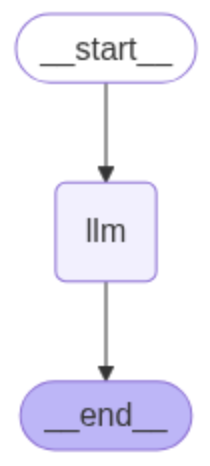

# LangGraph Basics

> [!IMPORTANT]
> This lecture requires `langgraph`. If you completed Lecture 4 Exercise 2 (MCP), you already have it. Otherwise, run from your `playground/` folder:
> ```bash
> uv add langgraph
> ```

LangGraph lets you build reliable, inspectable agent workflows as graphs. You define a typed state, add nodes (functions), connect them with edges, and optionally route conditionally. Tool use is modeled with a dedicated tool node.

## 1. A complete first example

### 1.1 The graph state

State is a single object passed between nodes. Keep it explicit and typed.

```python
from typing import Annotated

from typing_extensions import TypedDict

from langgraph.graph import StateGraph, START, END
from langgraph.graph.message import add_messages


class State(TypedDict):
    # Messages have the type "list". The `add_messages` function
    # in the annotation defines how this state key should be updated
    # (in this case, it appends messages to the list, rather than overwriting them)
    messages: Annotated[list, add_messages]
```

> [!NOTE]
> The `Annotated` object is usually used to document a specific data type. In this case it has the specific use of indicating to LangGraph that return statements such as `return {"messages": [ai_msg]}` results in a concatenation of the previous messages with the new ones.

What is the state and how is it used?

- **Single source of truth**: The state is one dictionary that flows through the graph. Every node receives it and returns updates to it.
- **Typed contract**: Use `TypedDict` to make keys explicit. This helps catch mistakes early.
- **Read, then return updates**: Nodes read values with `state["key"]`. To change something, return a new partial dict with only the keys you want to update. Unchanged keys can be omitted.

### 1.2 Define nodes (functions)

Nodes consume and return the state (partial updates are fine). Here the LLM appends an AI message. Crucially, nodes are defined as functions that receive the state as input and return the updated state through the update of the state (the dictionary).

```python
from langchain.chat_models import init_chat_model

# --- Configuration ---
# MODEL_NAME = "gemini-3-flash-preview"
# MODEL_PROVIDER = "google_genai"
MODEL_NAME = "my-model"
MODEL_PROVIDER = "openai"
BASE_URL = "https://myung-courageous-gino.ngrok-free.dev/v1"
API_KEY = "not-needed"

def call_llm(state: State) -> State:
    llm = init_chat_model(model=MODEL_NAME, model_provider=MODEL_PROVIDER, base_url=BASE_URL, api_key=API_KEY, temperature=0)
    ai_msg = llm.invoke(state["messages"])  # messages: List[BaseMessage]
    return {"messages": [ai_msg]}
```


### 1.3 Wire edges and compile the graph

```python
from langgraph.graph import StateGraph, END

workflow = StateGraph(State)
workflow.add_node("llm", call_llm)
workflow.set_entry_point("llm")
workflow.add_edge("llm", END)

graph = workflow.compile()
```

If you're running this code in a notebook you can now visualize the computational graph by simply calling

```python
graph
```



This is nothing more than the conventional one-shot message and response pattern. If we want to obtain a "chat" we need to add a loop.

```python
from langchain_core.messages import HumanMessage

loop = True
state = None
while loop:
    user_input = input("Your message: ")
    if user_input.lower() == "quit":
        break
    if state is None:
        state = graph.invoke({"messages": [HumanMessage(content=user_input)]})
    else:
        state["messages"].append(HumanMessage(content=user_input))
        state = graph.invoke(state)
    print(state["messages"][-1].content)
```

You see that the output of the invocation of the graph is the final state of the graph. In order to keep track of the memory what we need to do is add the new HumanMessage to the state and then invoke the graph again. This code delivered us a chatbot.


## 2. Conditional edges (routing)

One nice feature about LangGraph is that we can define conditional edges. We will start exploring this feature by building a very simple computational graph (with no LLM calls) that just shows how routing works.

```python
import random

class State(TypedDict):
    coin_flip: bool
    result: str

def coin_flip(state: State) -> State:
    return {"coin_flip": random.random() < 0.5}
```

We see two things:
- The state is a very simple annotated dictionary which only contains a single key `coin_flip` that evaluates to a boolean;
- The first node we define is a simple function that returns a random boolean (simulating a coin flip).

Let us now define a "router", a utility function that receives the state and, according to a custom logic, returns a string that will be used to route the flow of the graph.

```python
def router(state: State) -> str:
    return "head" if state["coin_flip"] else "tail"
```

Crucially, this function returns head if the coin flip evaluated to True and tail otherwise. Let us now instead define two "fictitious" nodes that will be used to route the flow of the graph. This nodes do nothing more than print a message to tell us the result of the coin flip.

```python
def result_head(state: State) -> State:
    print("Head")
    return {"result": "head"}

def result_tail(state: State) -> State:
    print("Tail")
    return {"result": "tail"}
```

We now have all the ingredients to build the graph:

```python
workflow = StateGraph(State)

# Define the nodes
workflow.add_node("coin_flip", coin_flip)
workflow.add_node("result_head", result_head)
workflow.add_node("result_tail", result_tail)

# Define the conditional edges
workflow.add_conditional_edges("coin_flip", router, {"head": "result_head", "tail": "result_tail"})

# Set the entry point and the edges
workflow.set_entry_point("coin_flip")
workflow.add_edge("result_head", END)
workflow.add_edge("result_tail", END)

# Compile the graph
graph = workflow.compile()
```

> [!NOTE]
> Let's breakdown in detail the structure of the conditional edges:
> The method takes as input three arguments:
> - The name of the source node from which the state is passed (the `coin_flip` node);
> - The function that will be used to route the flow of the graph (the `router` function);
> - A dictionary that maps the return values of the function to the next node (the `{"head": "result_head", "tail": "result_tail"}` dictionary).

We can now invoke the graph and see the result. Try to run the code multiple times to see how the result changes.

```python
graph.invoke({})
```

Again, if you are running this code in a notebook you can visualize the computational graph by simply calling

```python
graph
```

## 3. Tool node

LangGraph also provides us with a tool node that can be used to execute tool calls emitted by an LLM. This is a very powerful feature that allows us to build agents that can use tools to perform tasks. In this example we will build an agent that can (but is not forced to) use the `add` tool to add two integers. Crucially, this is the workflow:
- We give a query to the agent;
- The agent uses the LLM to generate a response;
- Then we have two possible scenarios:
    - If the LLM decides to use a tool, the tool node is called;
    - If the LLM decides not to use a tool, the agent uses its own knowledge to generate a response and exits
- (optional) If the LLM decides to use a tool, the tool node returns the result of the tool call to the agent to interpret it


As we did for the previous conditional edge example we start from scratch. Let us start by importing the necessary libraries and defining the tool.

```python
from langchain_core.messages import HumanMessage, SystemMessage
from typing import TypedDict, Annotated
from langgraph.graph.message import add_messages
from langgraph.graph import StateGraph, END
from langchain.chat_models import init_chat_model
```

We can then now define the state of the graph (equal to the previous example).

```python
class State(TypedDict):
    messages: Annotated[list, add_messages]
```

Let us also define the system prompt that we will give to this agent.

```python
sys_prompt = """
You are a helpful assistant. Who has access to tools. You use tools when it makes sense or otherwise you use your own knowledge."""
```

We can now dive into the core of this example and define the tool node.

```python
from langgraph.prebuilt import ToolNode
from langchain_core.tools import tool

@tool
def add(a: int, b: int) -> int:
    """Add two integers."""
    return a + b

tools = [add]
tool_node = ToolNode(tools)
```

As you can see, the definition of tools themselves is very simple and closely follows the definition of tools in LangChain that we saw in the previous lecture. To initialize the tool node we simply pass the list of tools to the `ToolNode` class.

Let us now also define the LLM node.

```python

def call_llm(state: State) -> State:
    llm = init_chat_model(model=MODEL_NAME, model_provider=MODEL_PROVIDER, base_url=BASE_URL, api_key=API_KEY, temperature=0)
    llm_with_tools = llm.bind_tools([add])
    ai_msg = llm_with_tools.invoke(state["messages"])  #
    return {"messages": [ai_msg]}
```

By leveraging what we learned in the section above we can also add a conditional edge to the graph that will decide whether to call the tools or not.

```python
def should_call_tools(state: State) -> str:
    last = state["messages"][-1]
    tool_calls = getattr(last, "tool_calls", [])
    return "tools" if tool_calls else "end"
```

Now that we have all of the ingredients we can define the graph.

```python
#define the graph
workflow = StateGraph(State)

#define the nodes
workflow.add_node("llm", call_llm)
workflow.add_node("tools", tool_node)

#define the edges
workflow.set_entry_point("llm")
workflow.add_conditional_edges("llm", should_call_tools, {"tools": "tools", "end": END})
workflow.add_edge("tools", "llm")

#compile the graph
graph = workflow.compile()
```

Try now to invoke the graph with a query that does not require the use of a tool.

```python
graph.invoke({"messages": [
    SystemMessage(content=sys_prompt),
    HumanMessage(content="What is the capital of France?")]})
```


You should see that the agent uses its own knowledge to generate a response and exits. Try now to invoke the graph with a query that requires the use of a tool.

```python
graph.invoke({"messages": [
    SystemMessage(content=sys_prompt),
    HumanMessage(content="What is 3 + 5?")]})
```

You should see that the agent uses the tool to generate a response.